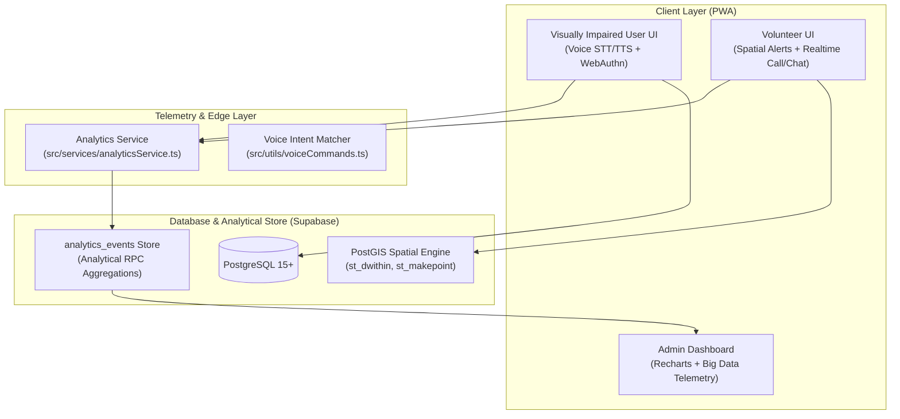

# BleNe Connect (ብሌን ኮኔክት)

> **Real-Time Volunteer Assistance & Accessibility Platform for the Visually Impaired**  
> Developed in collaboration with the **Ethiopian National Association of the Blind (ENAB)**.

[](package.json)
[](ACCESSIBILITY_FEATURES.md)
[](LICENSE)

---

## 🌟 Overview

**BleNe Connect** is an inclusive Progressive Web Application (PWA) designed to empower visually impaired individuals by connecting them with vetted, authenticated volunteers in real time. BleNe bridges accessibility gaps with voice-first interfaces, biometric authentication, PostGIS spatial dispatching, and high-throughput Big Data telemetry.

---

## 🚀 Key Features

### 1. ♿ Accessibility-First Design (WCAG 2.1 AA)
- **Voice-First Navigation:** Continuous Speech-to-Text (STT) and dynamic Text-to-Speech (TTS) audio announcements for every state change.
- **Biometric Quick Access:** Platform-native WebAuthn authentication (Face ID, Touch ID, Fingerprint, Windows Hello) enabling instant access without complex passwords.
- **Emergency SOS Mode:** Instant one-tap or voice-activated ("Emergency", "Immediate help") priority dispatch bypassing standard login friction.
- **Screen Reader Landmarks:** Fully structured with skip links, semantic landmarks, high-contrast themes, and dynamic focus management.

### 2. 🤖 AI & Intelligent Services
- **Voice Intent Detection:** Fuzzy matching and semantic categorization recognizing natural requests (*"cross the road"*, *"read this sign"*, *"where am I"*).
- **Privacy-Preserving Generalization:** Automatic sanitization of sensitive user requests before broadcasting to nearby volunteers.
- **Multimodal AI First-Responder Architecture:** Extensible edge vision pipelines (Gemini / OpenAI Vision / local ONNX) for instant offline document OCR, currency (Ethiopian Birr) recognition, and obstacle identification.

### 3. 📊 Big Data & Analytics Telemetry (New in v1.5)
- **High-Throughput Telemetry Ingestion (`analytics_events`):** Captures end-to-end operational metrics including request initiation, matching latencies, speech confidence, and volunteer acceptance times.
- **Urban Accessibility GIS & Blackspot Mapping:** Spatio-temporal PostGIS clustering that flags infrastructure hazards and high-density assistance corridors (e.g., Kirkos / Mexico Square, Piazza / Arada, Bole).
- **Time-Series Demand Forecasting:** 24-hour predictive demand trends enabling proactive volunteer scheduling during morning and evening rush hours.
- **Executive Admin Console:** Interactive Recharts dashboard providing real-time SLA metrics, fulfillment rates, and exportable JSON reports for ENAB urban advocacy.

---

## 🏗️ Architecture & Technology Stack



### Tech Stack Details
- **Frontend Framework:** React 18, TypeScript, Vite
- **Styling & UI:** Tailwind CSS, Radix UI (Shadcn UI primitives), Lucide Icons
- **Data Visualization:** Recharts
- **PWA & Offline:** Vite Plugin PWA, Service Workers, Web Cache API
- **Backend & Database:** Supabase (PostgreSQL 15+, PostGIS spatial extension)
- **Authentication:** Supabase Auth + Web Authentication API (WebAuthn)

---

## 🗄️ Database Schema & Migrations

Database migrations are located in [`supabase/migrations/`](file:///home/yon/Desktop/BleNe-V_1.5/supabase/migrations):

1. **[`01_initial_schema.sql`](file:///home/yon/Desktop/BleNe-V_1.5/supabase/migrations/01_initial_schema.sql):**
   - Enables `postgis` extension.
   - Creates `users`, `requests`, and `ratings` tables.
   - Defines `nearby_requests` PostGIS spatial query function.
2. **[`02_admin_roles_and_trigger.sql`](file:///home/yon/Desktop/BleNe-V_1.5/supabase/migrations/02_admin_roles_and_trigger.sql):**
   - Adds role-based permissions (`visually_impaired`, `volunteer`, `admin`).
   - Automatically handles user profile initialization via Postgres triggers.
3. **[`03_analytics_and_telemetry.sql`](file:///home/yon/Desktop/BleNe-V_1.5/supabase/migrations/03_analytics_and_telemetry.sql):**
   - Creates `analytics_events` table with PostGIS geometry triggers and indices.
   - Adds analytical RPCs:
     - `get_analytics_summary()`: Overall KPIs, fulfillment rate, average latency.
     - `get_hourly_demand_trend()`: 24-hour demand distribution.
     - `get_category_analytics()`: Help request breakdown by task type.
     - `get_district_analytics()`: Sub-city response time and spatial demand.
4. **[`04_encrypted_location.sql`](file:///home/yon/Desktop/BleNe-V_1.5/supabase/migrations/04_encrypted_location.sql):**
   - Adds `encrypted_location`, `location_iv`, and `is_location_encrypted` columns to `requests`.
   - Protects precise GPS coordinates with AES-256-GCM encryption.

---

## 🛠️ Getting Started

### Prerequisites
- [Node.js](https://nodejs.org/) (v18.x or v20.x recommended)
- [npm](https://www.npmjs.com/) or [bun](https://bun.sh/)
- A [Supabase](https://supabase.com/) project (with PostGIS enabled)

### Installation

1. **Clone the repository:**
   ```bash
   git clone https://github.com/your-org/BleNe-V_1.5.git
   cd BleNe-V_1.5
   ```

2. **Install dependencies:**
   ```bash
   npm install
   ```

3. **Configure Environment Variables:**
   Copy the example environment file:
   ```bash
   cp .env.example .env
   ```
   Populate your `.env` file:
   ```env
   VITE_SUPABASE_URL=https://your-project.supabase.co
   VITE_SUPABASE_ANON_KEY=your-anon-key-here
   ```

4. **Apply Supabase Migrations:**
   Run the migration files in order within your Supabase SQL Editor:
   - `supabase/migrations/01_initial_schema.sql`
   - `supabase/migrations/02_admin_roles_and_trigger.sql`
   - `supabase/migrations/03_analytics_and_telemetry.sql`
   - `supabase/migrations/04_encrypted_location.sql`

5. **Start the Development Server:**
   ```bash
   npm run dev
   ```
   Open [http://localhost:5173](http://localhost:5173) in your browser.

---

## 🧪 Testing & Verification

- **Type Check & Linting:**
  ```bash
  npm run lint
  ```
- **Production Build:**
  ```bash
  npm run build
  ```
- **Preview Production Build:**
  ```bash
  npm run preview
  ```

---

## 🔒 Security & Privacy

- **End-to-End Cryptographic Location Privacy (AES-256-GCM):**
  - Precise GPS coordinates (latitude, longitude, altitude, accuracy) are encrypted client-side using the native W3C Web Cryptography API (`window.crypto.subtle`) prior to transmission.
  - A fresh, cryptographically secure 96-bit (12-byte) Initialization Vector (IV) is generated for each location payload.
  - Authenticated encryption (AEAD) ensures that coordinates cannot be inspected or tampered with by eavesdroppers.
  - **Differential Privacy & Spatial Fuzzing:** The public PostGIS index only stores coarse coordinates jittered by ~300m for district-level proximity discovery, while the exact apartment/street location is only decrypted by the assigned volunteer upon request acceptance.
- **Biometric Security:** Biometric credentials never leave the user's secure hardware enclave; only non-reversible credential IDs are stored locally.
- **Location Privacy:** Geolocation is ephemeral and only requested when creating a help request or volunteer beacon.
- **Row Level Security (RLS):** Strict Supabase RLS ensures visually impaired users see only their own requests, while volunteers only access pending requests within active proximity.

---

## 📄 License

This project is open-source software licensed under the [MIT License](LICENSE).
