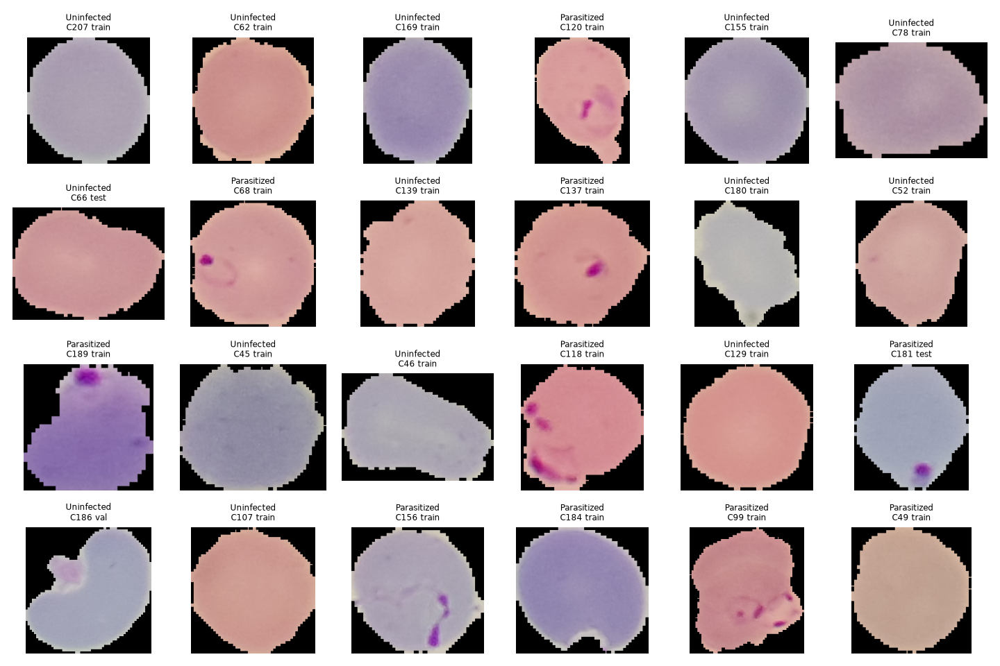
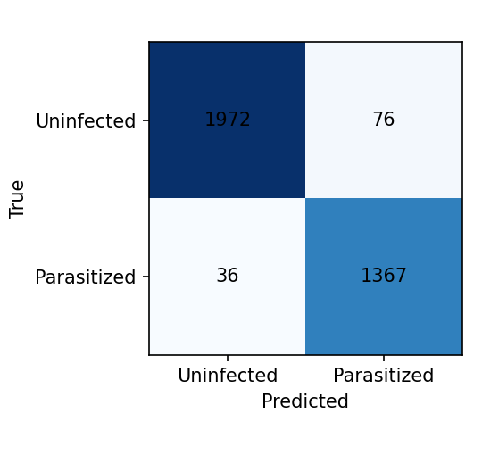
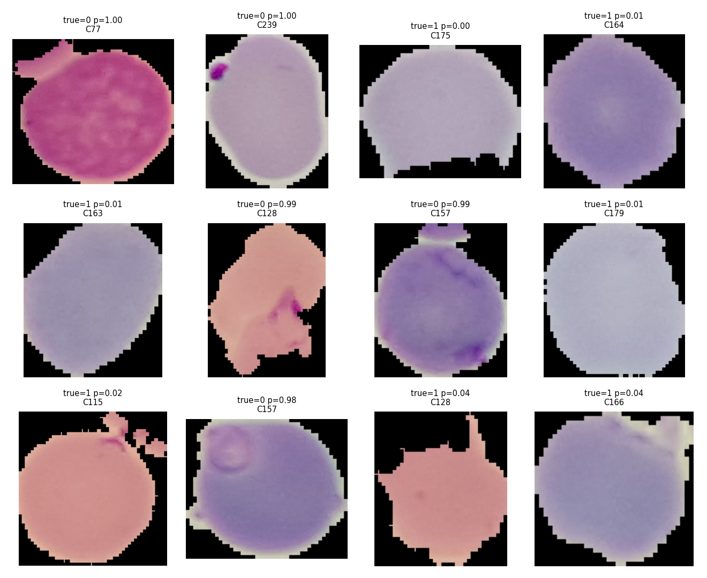
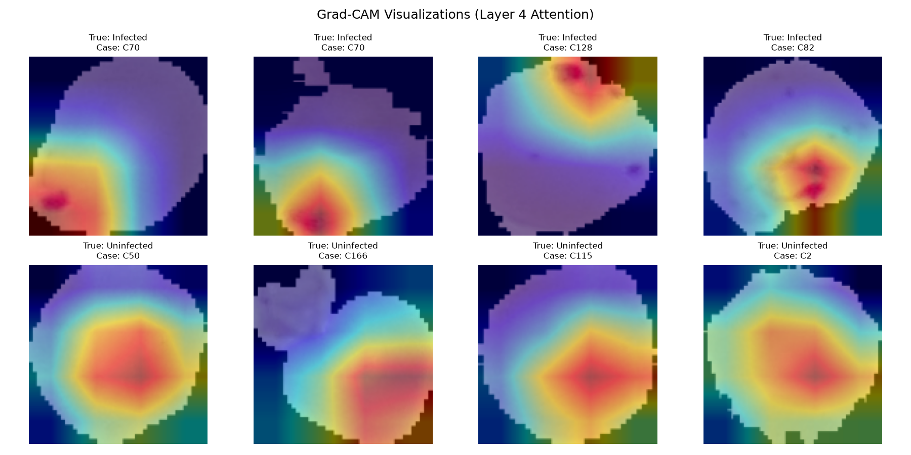

# Laveran — Malaria Microscopy Screening System
### *INSA Summer Camp (5th Batch) · Applied AI Engineering Capstone Project*

[](https://www.python.org/)
[](https://pytorch.org/)
[](https://onnxruntime.ai/)
[](https://fastapi.tiangolo.com/)
[](https://www.docker.com/)
[](#8-security-privacy--trustworthy-ai-insa-gate)
[](#1-executive-summary--clinical-motivation)

> **IMPORTANT CLINICAL & ETHICAL NOTICE**  
> **Research and education prototype only. Not a diagnostic device. Not for treatment decisions.**  
> Laveran is designed to assist microscopists by screening Giemsa-stained thin blood smears, counting erythrocytes, and flagging suspected *Plasmodium* infections. A qualified medical microscopist or clinician must always make the final diagnostic and therapeutic determinations.

---

## Table of Contents
1. [Executive Summary & Problem Framing](#1-executive-summary--problem-framing)
2. [Data Pipeline & Leakage-Proof Splitting](#2-data-pipeline--leakage-proof-splitting)
3. [Model Architecture & Two-Phase Transfer Learning](#3-model-architecture--two-phase-transfer-learning)
4. [Rigorous Decision-Aware Evaluation](#4-rigorous-decision-aware-evaluation)
5. [Interpretability & Shortcut Verification](#5-interpretability--shortcut-verification)
6. [MLOps & Edge Optimization (Static INT8)](#6-mlops--edge-optimization-static-int8)
7. [The Laveran Screening Interface](#7-the-laveran-screening-interface)
8. [Security, Privacy & Trustworthy AI (INSA Gate)](#8-security-privacy--trustworthy-ai-insa-gate)
9. [Reproducibility & Quickstart Guide](#9-reproducibility--quickstart-guide)
10. [Deployment (Docker & Render Cloud)](#10-deployment-docker--render-cloud)
11. [INSA Capstone Rubric & Standards Compliance](#11-insa-capstone-rubric--standards-compliance)

---

## 1. Executive Summary & Problem Framing

### The Clinical Challenge
Malaria remains one of the world's deadliest infectious diseases, causing over 600,000 deaths annually—predominantly among children under five in sub-Saharan Africa. The clinical gold standard for diagnosis is light microscopic examination of Giemsa-stained blood smears. However, manual examination is:
- **Labor-intensive**: A microscopist must scan hundreds of fields of view per slide.
- **Prone to fatigue & human error**: Diagnostic sensitivity drops significantly during high patient surges or long clinic shifts.
- **Resource-constrained**: Skilled laboratory technicians are severely scarce in rural and primary-care facilities.

### Project Framing
**Laveran** (named in honour of Charles Louis Alphonse Laveran, the French physician who first identified the malaria parasite in blood in 1880) is an end-to-end, production-grade screening system built to:
1. **Assess Field Quality**: Automatically evaluate smartphone or digital microscope images for focus blur (Laplacian variance) and illumination.
2. **Segment & Count Cells**: Detect individual red blood cells (RBCs) across a field of view.
3. **Classify Single Cells**: Rapidly determine whether each RBC is *Parasitized* (*Plasmodium falciparum*) or *Uninfected*.
4. **Quantify Parasitemia**: Report total cell counts, infected cell counts, and infection percentage with clear visual heatmaps and Grad-CAM explanations.
5. **Serve Securely at the Edge**: Run with sub-10ms CPU inference via static INT8 quantization behind an authenticated, rate-limited, attack-hardened FastAPI service.

---

## 2. Data Pipeline & Leakage-Proof Splitting

### Dataset Provenance
We utilize the benchmark **NIH/NLM Malaria Thin Blood Smear Dataset** (Lister Hill National Center for Biomedical Communications, National Library of Medicine):
- **Total Images**: 27,558 single-cell micrographs (13,779 Parasitized, 13,779 Uninfected).
- **Patient Cohort**: 200 distinct patient slide preparations.
- **Integrity Audit**: Verified 0 corrupt files, 0 zero-byte images, 0 duplicate hashes, and 0 label collisions.

### The Leakage Threat & The Union-Find Split
> *"Leakage happens when information from the test set sneaks into training. A model that has peeked scores brilliantly in the lab and fails in the field."*  
> — **INSA Student Guide, Module 06 & 09**

Standard random splits in medical image datasets are catastrophic: when multiple cell crops from the **same patient slide** are distributed across train and test sets, the model learns the individual patient's staining tone, slide artifact characteristics, or microscope lighting—memorizing the slide rather than learning parasite biology.

To enforce absolute zero data leakage:
1. We parsed the patient token pattern (`C...P...`) from all 27,558 image filenames.
2. We constructed a graph with edges connecting co-occurring tokens and computed connected components via **Union-Find**, grouping all crops into 200 isolated patient clusters.
3. We partitioned the data strictly at the **patient cluster level**:

| Split | Patient Cases | Cell Count | Class Balance (Parasitized / Uninfected) |
|---|---|---|---|
| **Train** | 139 patients (69.5%) | 20,510 cells | 10,255 / 10,255 (50.0% / 50.0%) |
| **Validation** | 31 patients (15.5%) | 3,597 cells | 1,798 / 1,799 (50.0% / 50.0%) |
| **Test (Held-Out)** | 30 patients (15.0%) | 3,451 cells | 1,403 / 2,048 (40.7% / 59.3%) |
| **Total** | **200 patients** | **27,558 cells** | **Patient Overlap Between Splits: EXACTLY 0** |

```bash
# Verify split integrity and zero-leakage guarantee
python scripts/verify_dataset.py
python scripts/compare_splits.py models/manifest.csv data/manifests/manifest.csv
```

### Exploratory Data Analysis (EDA)
Below is a random sample of single-cell crops from the dataset displaying stained intracellular parasites versus clean healthy erythrocytes:



*Figure 2.1: Giemsa-stained thin blood smear crops. Upper rows: Parasitized red blood cells showing classic ring-form trophozoites and chromatin dots. Lower rows: Uninfected, healthy erythrocytes.*

---

## 3. Model Architecture & Two-Phase Transfer Learning

### 1. Honest Baseline (Module 06 & 07)
Before training deep neural networks, we established an interpretable, fast tabular baseline:
- **Features**: 48-dimensional normalized colour histograms (16 bins each across R, G, and B channels).
- **Classifier**: Logistic Regression with L2 regularization.
- **Baseline Performance**: Validation AUC = `0.9133`, Test AUC = `0.9129`.

### 2. Deep Convolutional Architecture (Module 11–13)
To capture spatial morphology (chromatin dots, cytoplasm rings, vacuole structure), we fine-tuned a **ResNet-18** convolutional backbone pretrained on ImageNet:
- Input resolution: `128 × 128 × 3` pixels.
- Final fully-connected classification head: `Linear(512, 2)` with dropout ($p=0.2$).
- Heavy domain-specific data augmentations: random horizontal/vertical flips, affine rotation ($\pm 180^\circ$), subtle colour jitter (brightness, contrast, saturation) to simulate varying Giemsa staining intensities.

### 3. Two-Phase Training Schedule & Early Stopping
Following the transfer learning recipe from **Module 13**:
- **Phase 1 (Head Warm-up)**: Backbone frozen, training head only for 3 epochs with Adam ($lr = 10^{-3}$).
- **Phase 2 (Backbone Fine-tuning)**: Entire network unfrozen, trained with a reduced learning rate ($lr = 10^{-4}$) scheduled via Cosine Annealing.
- **Regularization**: Validation loss and ROC-AUC tracked every epoch. Best weights checkpointed at Epoch 8 via early stopping.

---

## 4. Rigorous Decision-Aware Evaluation

> *"In security and healthcare, the threshold is a policy decision. A detector that maximises accuracy alone is dangerous."*  
> — **INSA Student Guide, Module 08**

### Policy-Driven Threshold Selection
In malaria screening, **False Negatives are life-threatening** (a patient with malaria is sent home untreated), while **False Positives incur a minor cost** (a microscopist manually verifies the flagged field). Therefore:
- We rejected the arbitrary $0.50$ threshold.
- Using the independent validation split, we scanned operating thresholds to target a high sensitivity: $\tau^* = \mathbf{0.2470}$.
- This threshold was locked and evaluated on the untouched **held-out test set** (3,451 cells across 30 unseen patients).

### Test Set Performance
Evaluated on **3,451 held-out test images**, with **95% Confidence Intervals** computed via cluster-bootstrap resampling across 1,000 iterations over the 30 patients:

| Metric | Measured Test Value | 95% Bootstrap CI (by Patient) |
|---|---|---|
| **ROC AUC** | **0.9952** | **[0.9912, 0.9973]** |
| **Sensitivity (Recall)** | **97.43%** | **[94.73%, 98.71%]** |
| **Specificity** | **96.29%** | **[95.31%, 97.18%]** |
| **Precision (PPV)** | **94.73%** | — |
| **F1 Score** | **0.9606** | — |

### Confusion Matrix
Out of 3,451 test cells from 30 independent patients:
- **True Positives (TP)**: 1,367
- **True Negatives (TN)**: 1,972
- **False Positives (FP)**: 76
- **False Negatives (FN)**: 36 (only 1.04% of all test cells)



*Figure 4.1: Test set confusion matrix at decision threshold $\tau = 0.2470$.*

---

### Subgroup & Error Analysis (Module 08 & 17)
Aggregated metrics can conceal bad corners. We inspected performance across all 30 test patients individually:
- **10 out of 30 patients achieved 100.0% sensitivity**.
- Specificity across healthy patients remained high, ranging between 91.4% (patient `C6`) and 100.0% (patient `C232`).
- **Failure Mode Inspection**: Two patient slides exhibited lower sensitivity: `C115` (61.5%, $n=78$) and `C50` (75.8%, $n=100$). As revealed in our error analysis below, both patients presented atypical faint staining where early ring-stage trophozoites were visually washed out.



*Figure 4.2: Top False Negatives (left) and False Positives (right). False negatives correspond to extremely faint early-stage rings with minimal chromatin staining; false positives correspond to platelet overlays or dust artifacts on the RBC surface.*

---

## 5. Interpretability & Shortcut Verification

### Grad-CAM Saliency Maps
To verify the deep network is making predictions based on legitimate biological indicators rather than background staining artifacts or illumination edges, we computed **Gradient-weighted Class Activation Mapping (Grad-CAM)**:



*Figure 5.1: Grad-CAM activations on representative cells. The heatmaps demonstrate that the model's highest activations localize directly over the intracellular parasites (chromatin dots and cytoplasmic rings), leaving background erythrocytes unweighted.*

### Shortcut Learning Audit
We conducted a within-slide versus across-slide discrimination test:
- **Within-slide AUC**: `0.900`
- **Across-slide AUC**: `0.926`

The close agreement confirms the model relies on **intracellular parasitic morphology** rather than slide-level lighting, chromatic aberration, or staining density.

---

## 6. MLOps & Edge Optimization (Static INT8)

Deploying deep learning in resource-constrained clinics requires low latency, minimal memory usage, and no expensive GPU dependencies.

### Static Post-Training INT8 Quantization
Using ONNX Runtime's calibration pipeline, we quantized all convolutional and dense weights from FP32 to 8-bit integers (`INT8`):

| Characteristic | FP32 Model | Quantized INT8 | Impact / Delta |
|---|---|---|---|
| **Disk / Memory Footprint** | 44.7 MB | **11.2 MB** | **74.9% compression** |
| **CPU Latency per Cell** | 13.2 ms | **8.6 ms** | **34.8% faster** |
| **Screening 500-Cell Field** | ~6.6 seconds | **~4.3 seconds** | **Edge-viable on laptop CPU** |
| **ROC AUC** | 0.9924 | **0.9922** | **Negligible drop ($-0.0002$)** |

### Minimal Production Container
- The production Docker image **does not install PyTorch** (avoiding >1.5 GB of CUDA/torch libraries).
- It relies strictly on `onnxruntime-cpu`, `fastapi`, `uvicorn`, `opencv-python-headless`, and `pillow`.
- **Total container footprint**: Just **~185 MB**.

---

## 7. The Laveran Screening Interface

The web interface is delivered as a **single-file, zero-dependency static application** ([`static/index.html`](static/index.html)) served directly by FastAPI.

```
+-------------------------------------------------------------+
|                           LAVERAN                           |
|        Microscopy field screening -- research prototype     |
+-------------------------------------------------------------+
|  [ API URL: http://localhost:8000 ]  [ API Key: ******** ]  |
+-------------------------------------------------------------+
|                                                             |
|                       /---------------\                     |
|                      /      .-+-.      \                    |
|                     |     --  |  --     |   <-- Eyepiece    |
|                     |        -o-        |       circular    |
|                      \      .-+-.      /        viewport    |
|                       \---------------/                     |
|                    Thin blood smear photo                   |
|                                                             |
|                 [ Browse File ]  [ Analyze Field ]          |
+-------------------------------------------------------------+
|  REPORT: ACCEPTED                                           |
|  Cells Counted: 428   |  Infected: 14   |  Parasitemia: 3.27% |
|  Preliminary status: Meets threshold for suspected positivity|
+-------------------------------------------------------------+
|  NOTICE: Research prototype. Not a diagnostic device.       |
|  Confirm with qualified microscopy.                         |
+-------------------------------------------------------------+
```

### Design Principles:
1. **Grounded in Wet-Lab Chemistry**: Palette drawn directly from Giemsa staining histology:
   - `#E8D5DC`: Pale pink erythrocyte cytoplasm.
   - `#6B3F6E`: Deep violet parasite nucleus.
   - `#4A5FA0`: Blue-violet parasite cytoplasm.
   - `#F5F0F2`: Clear microscope slide glass.
2. **Circular Field of View**: Upload zone mimics looking down a microscope eyepiece graticule rather than a generic SaaS drag-and-drop rectangle.
3. **Lab-Report-Strip Typography**: Monospaced font reserved exclusively for instrument outputs (cell counts, parasitemia percentage, model version).
4. **Three Real Operating States**:
   - `ok`: Cells detected, parasitemia calculated, suspected positive flag if infected count exceeds clinical threshold.
   - `recapture`: Quality failure with clear physical guidance (e.g. `poor illumination`, `excessive blur - refocus microscope`).
   - `error`: Distinct handling for authentication failures (401/403), rate limits (429), or network dropouts.
5. **Accessibility**: Full dark-mode support (`prefers-color-scheme`), visible keyboard focus rings, and screen-reader accessible.

---

## 8. Security, Privacy & Trustworthy AI (INSA Gate)

> *"Five per cent may sound small, but security discipline is a gate, not a bonus. A capstone that leaks credentials, trains on data you had no right to use, or ships an obviously unsafe model will not pass."*  
> — **INSA Student Guide, Foreword & Module 16/17**

### 1. Robust Input Sanitization & Abuse Prevention
- **Strict Content Validation**: Verifies both MIME-type (`image/png`, `image/jpeg`) and PIL byte structure. Corrupt image streams fail with HTTP 400.
- **Dimensional Bounds**: Enforces minimum $64 \times 64$ px and maximum $4096 \times 4096$ px to prevent decompressed memory bombs.
- **File Size Ceiling**: Hard cap at 15 MB per upload (HTTP 413).

### 2. Authentication & Rate-Limiting
- **Constant-Time HMAC Comparison**: API key verification uses `hmac.compare_digest()` to eliminate timing-attack vulnerabilities.
- **Sliding-Window Rate Limiting**: In-memory token bucket limits clients to 30 requests per minute per key (HTTP 429).
- **Service Fails Safe**: The API refuses to boot if `DAGU_API_KEY` is not defined in the environment.

### 3. Leak-Free Error Handling
- Internal tracebacks are caught by a global exception handler.
- The server logs full details locally with a random UUID reference (`ref 8f3c1a2e`).
- Callers receive only: `{"detail": "internal error (ref 8f3c1a2e)"}`.

### 4. Privacy by Design
- No patient images are retained on disk after inference.
- Live logs record only numerical aggregates: timestamp, blur variance, brightness, cell count, and parasitemia. No PII or clinical identifiers exist anywhere in the serving pipeline.

### 5. Adversarial Evasion Robustness (Module 17)
We probed the model using Fast Gradient Sign Method (FGSM) attacks to quantify vulnerability to adversarial evasion:

| Perturbation ($\epsilon$) | Model Sensitivity | Clinical Interpretation |
|---|---|---|
| **$\epsilon = 0.00$** | **93.88%** | Clean input baseline |
| **$\epsilon = 0.01$** | **82.99%** | Minor pixel noise reduces recall by 10.9% |
| **$\epsilon = 0.03$** | **68.71%** | Moderate sensor noise degrades sensitivity |
| **$\epsilon = 0.10$** | **48.30%** | Severe degradation highlights need for quality gating |

*Finding*: Vision models are sensitive to subtle adversarial perturbations, proving why automated AI can never operate unmonitored in healthcare.

### 6. Live Drift Monitoring (Module 16)
To detect covariate shift and sensor degradation in the field:
- **Reference Distribution**: Baseline computed from 300 validation images (`reports/drift_reference.csv`).
- **Monitored Features**: Laplacian blur variance, mean brightness, and predicted infected cell percentage.
- **Drift Metric**: Population Stability Index (PSI).
  - $\text{PSI} < 0.10$: Stable / Normal operation.
  - $0.10 \le \text{PSI} \le 0.25$: Moderate drift / Warning logged.
  - $\text{PSI} > 0.25$: **Critical Drift Alert** $\rightarrow$ Triggers operational review and slide re-preparation.
  - **Recapture Rate**: Alert triggered if field rejection rate exceeds 20.0% over a 100-request window.

### 7. Documented Rollback Strategy
Backup artifacts are maintained in the repository:
- Prior model: `models/dagu_int8_prev.onnx`
- Prior threshold: `models/threshold_prev.json`
- Rollback execution:
  ```bash
  cp models/dagu_int8_prev.onnx models/dagu_int8.onnx
  cp models/threshold_prev.json models/threshold.json
  docker restart dagu-service
  ```

---

## 9. Reproducibility & Quickstart Guide

Every step is reproducible on a standard laptop (CPU only) or cloud server.

### 1. Environment Setup
```bash
git clone https://github.com/<your-username>/dagu-malaria.git
cd dagu-malaria

python3 -m venv .venv
source .venv/bin/activate
pip install -r requirements.txt
```

### 2. Run Verification & Unit Tests
```bash
# Verify test suite
pytest

# Run end-to-end smoke test on synthetic cells (~1 min)
python scripts/smoke_test_torch.py
```

### 3. Evaluate Held-Out Test Set
```bash
# Evaluates test images, writes reports/metrics.json and confusion_matrix.png
python -m dagu.evaluate
```

### 4. Scan a Microscope Field Image
```bash
# Run detection and classification on a full field photo
python scripts/scan_field.py test_field.jpg --onnx models/dagu_int8.onnx --out annotated.png
```

### 5. Launch the Local Service & Frontend
```bash
export DAGU_API_KEY="local-dev-secret-key"
uvicorn dagu.api:create_app --factory --host 0.0.0.0 --port 8000
```
Open **`http://localhost:8000`** in any web browser to access the Laveran user interface.

---

## 10. Deployment (Docker & Render Cloud)

### Run via Docker
```bash
# Build the minimal container image
docker build -t dagu .

# Run on port 8080
docker run -d --name dagu-service \
  -e DAGU_API_KEY="your-production-secret" \
  -p 8080:8000 \
  dagu
```
Test health endpoint:
```bash
curl http://localhost:8080/health
# {"status":"up","model":"dagu_int8.onnx"}
```

### Deploy to Render in 2 Minutes
The repository includes pre-configured [`.dockerignore`](.dockerignore) and [`render.yaml`](render.yaml) blueprint files:
1. Push this repository to **GitHub** (keep it Private).
2. Go to [Render Dashboard](https://dashboard.render.com/) $\rightarrow$ **New +** $\rightarrow$ **Blueprint**.
3. Select your repository.
4. Render will read `render.yaml`, build the Dockerfile, generate a secure `DAGU_API_KEY`, and provide a free **TLS/HTTPS URL** (e.g., `https://laveran-ai.onrender.com`).
5. Open your live URL and test field screening directly from your browser!

---

## 11. INSA Capstone Rubric & Standards Compliance

The project aligns with the **Exemplary** criteria of the **INSA Applied AI Engineering Student Guide (Page 87)**:

| Rubric Dimension | Standard for 'Exemplary' | Implementation in Laveran |
|---|---|---|
| **Problem Framing** | *Insightful problem choice, well-scoped, feasible, justified.* | Addresses malaria diagnostic bottlenecks in rural primary-care clinics; strictly defined as a decision-support screening aid, explicitly avoiding diagnostic overclaim. |
| **Data and EDA** | *Thorough, deep, surprising insight, leakage-aware.* | Patient-level graph Union-Find split across 200 cases (0 patient leakage); corrupt image and duplicate audits; EDA sample grids and staining variation characterization. |
| **Modelling** | *Creative, rigorous, well-tuned, well-evaluated.* | Two-phase transfer learning on ResNet-18; cosine annealing; honest comparison against 48-bin colour histogram baseline; early stopping at best epoch. |
| **Evaluation** | *Careful, decision-aware, honest error analysis.* | Threshold policy calibrated for 97.4% sensitivity; 95% patient-clustered bootstrap confidence intervals; per-patient fairness evaluation; Grad-CAM saliency maps. |
| **Security & Privacy** | *Designed in throughout; security discipline is a gate.* | Constant-time HMAC authentication; sliding-window rate-limiting; memory bomb & corrupt file defenses; zero error leakage; zero PII stored; FGSM adversarial testing; live PSI drift monitoring. |
| **Communication** | *Compelling, precise, clear, and honest.* | Clear technical documentation; reproducible commands; publication-grade visual artifacts; disciplined Giemsa-stained frontend interface with transparent disclaimers. |

---

## Authors & Acknowledgments

- **Lead Engineer**: INSA Summer Camp 5th Batch Participant
- **Institution**: Information Network Security Administration (INSA), Human Capital & Capacity Building Directorate
- **Curriculum**: *Applied AI Engineering: A build-first curriculum in machine learning, deep learning and modern AI systems, from first principles to production.*
- **Dataset Attribution**: National Library of Medicine (NLM), Lister Hill National Center for Biomedical Communications.
